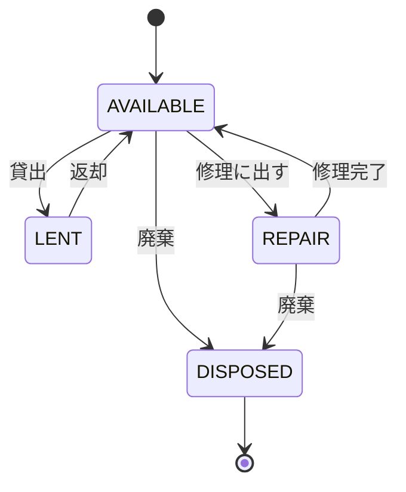
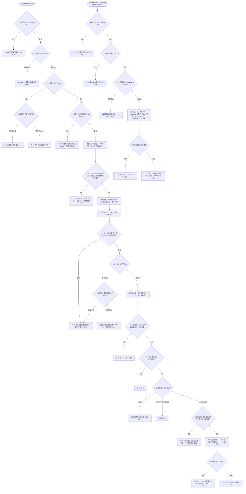

# PC貸出処理 要件定義書 v1.0（例外系補完版）

元仕様（Gate5 配布資料 2. PC 貸出機能 仕様書・正常系のみ）の正常系は変更せず、異常系・境界値・同時実行を補完したもの。
洗い出しの経緯は `01_例外系洗い出し表.md`、仮決めした点は `03_確認事項.md` を参照。

---

## 1. 概要

| 項目 | 内容 |
|---|---|
| 機能名 | PC 貸出処理（貸出申請・返却） |
| 対象ユーザー | 社員（共用ノートPC の借用者） |
| 目的 | 共用ノートPC の貸出状況を正確に管理し、二重貸出・返却漏れ・延滞を防ぐ |
| 操作者 | ログイン済みの社員。操作者の user_id は常にログイン情報から取得する（R-09） |
| 貸出対象 | device_type が LAPTOP の端末のみ |

## 2. 用語定義

| 用語 | 定義 |
|---|---|
| 端末 | devices テーブルの 1 件。資産番号（例：PC-0001）で識別する |
| 貸出 | 社員が端末を一時的に借りること。lendings の 1 レコードで表す |
| 未返却 | lendings.returned_at が NULL の状態 |
| 延滞 | 未返却で、今日が返却予定日より後の状態（返却予定日の当日は延滞ではない） |
| 確認トークン | 確認画面の表示時に発行する 1 回限りの識別子。確定処理に必須 |
| 本人 | lendings.user_id がログイン中の社員 ID と一致する社員 |
| 有効な社員 | employees.employment_status が ACTIVE の社員 |

## 3. データ定義

### devices（端末）テーブル

| カラム名 | 型 | NULL | デフォルト | 説明 |
|---|---|---|---|---|
| id | BIGINT | NO | AUTO | 主キー |
| asset_no | VARCHAR(20) | NO | - | 資産番号（例：PC-0001）。一意 |
| model_name | VARCHAR(50) | NO | - | 機種名 |
| device_type | VARCHAR(20) | NO | - | LAPTOP / TABLET / MONITOR |
| status | VARCHAR(20) | NO | ‘AVAILABLE’ | ステータス（4. 参照） |
| purchased_at | DATE | NO | - | 購入日 |

### lendings（貸出）テーブル

| カラム名 | 型 | NULL | デフォルト | 説明 |
|---|---|---|---|---|
| id | BIGINT | NO | AUTO | 主キー |
| device_id | BIGINT | NO | - | 端末 ID（devices.id への外部キー） |
| user_id | BIGINT | NO | - | 借用者 ID（employees.id への外部キー） |
| lent_at | DATETIME | NO | 現在日時 | 貸出日時 |
| due_date | DATE | NO | - | 返却予定日 |
| returned_at | DATETIME | YES | NULL | 返却日時（未返却は NULL） |
| purpose | VARCHAR(100) | NO | - | 利用目的（前後の空白除去後） |

### employees（社員）テーブル

| カラム名 | 型 | NULL | デフォルト | 説明 |
|---|---|---|---|---|
| id | BIGINT | NO | AUTO | 主キー |
| employee_code | VARCHAR(10) | NO | - | 社員コード（例：E-1011）。一意。**今回追加** |
| name | VARCHAR(50) | NO | - | 氏名 |
| department | VARCHAR(50) | NO | - | 部署名 |
| employment_status | VARCHAR(20) | NO | ‘ACTIVE’ | ACTIVE（在籍）/ LEAVE（休職）/ RETIRED（退職） |

### lending_requests（貸出確認）テーブル　※今回追加

確認画面で見せた内容と、確定処理の結果を保持する。

| カラム名 | 型 | NULL | デフォルト | 説明 |
|---|---|---|---|---|
| token | VARCHAR(32) | NO | - | 主キー。確認トークン |
| user_id | BIGINT | NO | - | 発行時の操作者 ID |
| device_id | BIGINT | NO | - | 確認画面で見せた端末 ID |
| due_date | DATE | NO | - | 確認画面で見せた返却予定日 |
| purpose | VARCHAR(100) | NO | - | 確認画面で見せた利用目的 |
| created_at | DATETIME | NO | 現在日時 | 発行日時（発行から 30 分で期限切れ） |
| used_at | DATETIME | YES | NULL | 確定処理で消費した日時（未使用は NULL） |
| lending_id | BIGINT | YES | NULL | 確定が成功したときの lendings.id |

### 制約

| 対象 | 制約 |
|---|---|
| lendings | 未返却（returned_at が NULL）の行は device_id ごとに 1 件まで（部分ユニーク） |
| lendings | 未返却（returned_at が NULL）の行は user_id ごとに 1 件まで（部分ユニーク） |
| devices.status | AVAILABLE / LENT / REPAIR / DISPOSED のいずれか |
| employees.employment_status | ACTIVE / LEAVE / RETIRED のいずれか |
| devices.asset_no / employees.employee_code | 一意 |

## 4. ステータスの定義と遷移

### devices.status

| コード | 表示名 | 意味 |
|---|---|---|
| AVAILABLE | 貸出可能 | 誰にも貸し出されていない。貸出できる |
| LENT | 貸出中 | 誰かが借りている。未返却の lendings が 1 件ある |
| REPAIR | 修理中 | 修理に出している。貸出できない |
| DISPOSED | 廃棄済み | 廃棄した。終端状態で、元に戻せない |

### 遷移可能な組み合わせ（これ以外は不可）

| 変更前 ＼ 変更後 | AVAILABLE | LENT | REPAIR | DISPOSED |
|---|---|---|---|---|
| AVAILABLE | - | ○ | ○ | ○ |
| LENT | ○ | - | × | × |
| REPAIR | ○ | × | - | ○ |
| DISPOSED | × | × | × | - |

補足：
- AVAILABLE → LENT は「貸出」、LENT → AVAILABLE は「返却」でのみ行う。それ以外の経路では変更できない
- LENT → REPAIR / DISPOSED は不可。必ず一度返却（LENT → AVAILABLE）を経由させる（E-28）
- REPAIR → LENT は不可。修理中の端末は一度 AVAILABLE に戻してから貸し出す
- DISPOSED からはどのステータスにも遷移できない
- AVAILABLE → REPAIR / DISPOSED、REPAIR → AVAILABLE / DISPOSED の操作画面は今回の範囲外。遷移の可否判定のみを定義する

### 状態遷移図



### 貸出（lendings）の表示区分

| 区分 | 条件 | 表示 |
|---|---|---|
| 貸出中 | returned_at が NULL かつ 今日 ≦ 返却予定日 | 貸出中 |
| 延滞 | returned_at が NULL かつ 今日 ＞ 返却予定日 | 延滞 N 日（N ＝ 今日 − 返却予定日） |
| 返却済み | returned_at が NULL でない | 返却済み |

### 社員の在籍区分と貸出可否

| コード | 表示名 | 貸出 |
|---|---|---|
| ACTIVE | 在籍 | 可 |
| LEAVE | 休職 | 不可（E-09） |
| RETIRED | 退職 | 不可（E-08） |

## 5. 貸出・返却に伴う付随処理

| 処理 | 付随処理 |
|---|---|
| 貸出（AVAILABLE → LENT） | lendings に 1 レコード登録する（lent_at ＝ 現在日時、returned_at ＝ NULL）。devices.status を LENT に更新する。lending_requests の used_at と lending_id を設定する |
| 返却（LENT → AVAILABLE） | lendings.returned_at に現在日時を設定する（returned_at が NULL の行のみ）。devices.status を AVAILABLE に更新する |
| 貸出・返却の全て | 上記の更新を 1 トランザクションで行う（N-01） |
| 返却時、返却予定日を過ぎていた場合 | 完了メッセージに S-03 を使う |

## 6. 業務ルール

### 6.1 ルール一覧

| No | ルール | 洗い出し No |
|---|---|---|
| R-01 | 貸出できる端末は device_type が LAPTOP かつ status が AVAILABLE のものだけ | 1,2,3,6 |
| R-02 | 貸出できる社員は employment_status が ACTIVE の社員のみ（休職・退職は不可） | 7,8 |
| R-03 | 1 人が同時に借りられるのは 1 台まで。未返却の貸出が 0 件の社員のみ新規貸出できる | 10,15 |
| R-04 | 延滞中の社員（未返却で返却予定日が今日より前）は新規貸出できない。R-03 より先に判定し、メッセージを分ける（E-12 / E-11） | 30 |
| R-05 | 返却予定日は明日から 14 日後まで（両端を含む）。土日は不可。祝日は判定しない | 17,18,20,25 |
| R-06 | 未返却の貸出は 1 端末につき最大 1 件 | 1,12 |
| R-07 | 貸出・返却は lendings と devices の更新を 1 トランザクションで行う。書き込みロックを先に取り、ロック取得後に検証をやり直す | 12,33,34 |
| R-08 | 貸出の確定は確認トークンで行う。使用済みのトークンでは再処理せず、前回成功していればその結果を再表示する | 13,14 |
| R-09 | 操作者の user_id は常にログイン情報から取得する。リクエストに含まれる user_id は無視する | 38 |
| R-10 | 返却できるのは貸出した本人のみ | 11 |
| R-11 | returned_at は一度設定したら更新しない（更新条件に returned_at が NULL を含める） | 27 |
| R-12 | devices.status の変更は 4. の遷移表で ○ の組み合わせのみ | 28 |
| R-13 | 日付の判定はサーバー時刻（日本時間）のみで行う。延滞は「今日 ＞ 返却予定日」で、返却予定日の当日は延滞ではない。時刻による締めはない | 29,31,32 |
| R-14 | 確定時に、入力チェック・社員の状態・端末の状態をすべてサーバー側でもう一度行う | 31,37 |
| R-15 | 確定時に登録する端末・返却予定日・利用目的は、確認画面の表示時に lending_requests へ保存した値を使う。確定リクエストに含まれる値は使わない | 39 |
| R-16 | 利用目的は前後の空白（半角・全角）を除去して保存する。画面表示では必ず HTML エスケープする | 21,23 |
| R-17 | 貸出可能な端末が 0 件のとき、プルダウンを空で表示せず E-07 を表示し、「貸出する」ボタンを非活性にする | 5 |

### 6.2 チェックの順序

複数の違反が同時にあるときは、最初に該当したものだけを表示する。

| 順 | チェック | メッセージ |
|---|---|---|
| 1 | 社員の存在 | E-10 |
| 2 | 在籍区分（R-02） | E-08 / E-09 |
| 3 | 延滞中の貸出（R-04） | E-12 |
| 4 | 未返却の貸出（R-03） | E-11 |
| 5 | 入力値（返却予定日 → 利用目的の順に、形式 → 範囲 → 文字数） | E-16〜E-22 / E-24 |
| 6 | 端末の存在 | E-05 |
| 7 | 端末の種別（R-01） | E-06 |
| 8 | 端末の状態（R-01） | E-01（確定時は E-02）/ E-03 / E-04 |

確定時（トランザクション内）は 1〜4、6〜8 を行ったうえで、返却予定日の範囲（R-05）を再確認する（違反は E-23）。

## 7. 入力項目の定義（バリデーション）

トリム ＝ 前後の空白（半角・全角）を除去してから判定する。文字数は Unicode のコードポイント数で数える。

| No | 画面 | 項目名 | 必須 | 型 | 最小 | 最大 | 使用可能文字 | トリム | 業務チェック | エラーメッセージ |
|---|---|---|---|---|---|---|---|---|---|---|
| I-01 | 貸出申請 | 機種（device_id） | ○ | 整数（正） | 1 | - | 半角数字 | - | devices に存在する／LAPTOP である／AVAILABLE である（R-01） | 形式不正：E-24／存在しない：E-05／種別：E-06／貸出中：E-01／修理中：E-03／廃棄済み：E-04 |
| I-02 | 貸出申請 | 返却予定日（due_date） | ○ | 日付 | 翌日 | 14 日後 | 半角数字、`/`、`-`（`YYYY/MM/DD` または `YYYY-MM-DD`） | ○ | 実在する日付／土日は不可（R-05） | 未入力：E-16／形式不正・実在しない日付：E-17／範囲外（当日・過去・15 日後以降）：E-18／土日：E-19 |
| I-03 | 貸出申請 | 利用目的（purpose） | ○ | 文字列 | 1 | 100 | 改行・制御文字を除くすべての文字（絵文字・機種依存文字・`<` `>` を含む） | ○ | - | 未入力・空白のみ：E-20／101 文字以上：E-21／改行・制御文字を含む：E-22 |
| I-04 | 確認（確定） | 確認トークン（token） | ○ | 文字列 | 32 | 32 | 半角英数（16 進） | - | lending_requests に存在する／発行者が操作者本人／発行から 30 分以内／未使用（R-08） | E-15（使用済みで前回成功済みは E-14） |
| I-05 | 返却 | 貸出 ID（lending_id） | ○ | 整数（正） | 1 | - | 半角数字 | - | lendings に存在する／本人の貸出（R-10）／returned_at が NULL（R-11） | 存在しない：E-27／他人の貸出：E-13／返却済み：E-26／貸出中でない：E-25 |

操作者（user_id）は画面入力項目ではない（R-09）。

## 8. 画面仕様

### 8.1 貸出申請画面（正常時）

```
┌──────────────────────────────────────────────┐
│ PC 貸出申請                                   │
├──────────────────────────────────────────────┤
│ （エラー・案内メッセージ表示欄）               │
├──────────────────────────────────────────────┤
│ 機種      ： [ PC-0003（機種名） ▼ ]          │
│ 返却予定日 ： [ 2026/08/05 ]                  │
│              （エラー表示欄）                 │
│ 利用目的   ： [                          ]    │
│              （エラー表示欄）                 │
│                              [ 貸出する ]     │
└──────────────────────────────────────────────┘
```

### 8.2 確認画面

```
┌──────────────────────────────────────────────┐
│ 貸出内容の確認                                 │
├──────────────────────────────────────────────┤
│ 機種      ： PC-0003（機種名）                 │
│ 返却予定日 ： 2026/08/05                      │
│ 利用目的   ： 出張                            │
│                                               │
│          [ 戻る ]            [ 確定 ]         │
└──────────────────────────────────────────────┘
```

### 8.3 貸出完了画面

```
┌──────────────────────────────────────────────┐
│ ✔ PC-0003 を貸し出しました。                    │
│   返却予定日は 2026/08/05 です。               │
│   （E-14 の注記表示欄）                        │
└──────────────────────────────────────────────┘
```

### 8.4 返却画面

```
┌──────────────────────────────────────────────┐
│ PC 返却                                       │
├──────────────────────────────────────────────┤
│ （エラー表示欄）                               │
├──────────────────────────────────────────────┤
│ 借りている端末：                               │
│  ( ● ) PC-0003（機種名）                      │
│         貸出日時 2026/07/29 10:15             │
│         返却予定日 2026/08/05  [延滞 3日]      │
│         利用目的 出張                          │
│                              [ 返却する ]     │
└──────────────────────────────────────────────┘
```

### 8.5 返却完了画面

```
┌──────────────────────────────────────────────┐
│ ✔ PC-0003 を返却しました。                      │
│   （延滞していた場合の注記表示欄）              │
└──────────────────────────────────────────────┘
```

### 8.6 表示ルール

| No | ルール |
|---|---|
| V-01 | 機種プルダウンには device_type が LAPTOP かつ status が AVAILABLE の端末のみを、資産番号の昇順で「PC-0003（機種名）」の形式で表示する |
| V-02 | 貸出可能な端末が 0 件の場合、プルダウンを表示せず E-07 を表示し、「貸出する」ボタンを非活性にする |
| V-03 | 操作者が有効な社員でない場合（E-08 / E-09）、または未返却の貸出がある場合（E-11 / E-12）、該当メッセージをエラー表示欄に表示し、「貸出する」ボタンを非活性にする。入力欄は表示する |
| V-04 | 入力エラーは該当項目の下に赤字で表示する。画面上部のエラーは赤い帯で表示する。入力済みの値は消さずに再表示する |
| V-05 | 確認画面で「確定」を押した直後から、ボタンを非活性にして「処理中…」と表示する |
| V-06 | 確認画面の「戻る」を押すと、入力済みの値を保持した状態で貸出申請画面に戻る |
| V-07 | 確認画面と貸出完了画面は、ブラウザにキャッシュさせない（Cache-Control: no-store） |
| V-08 | 返却画面には、操作者本人の未返却の貸出のみを表示する。0 件の場合は「返却する端末はありません」と表示し、「返却する」ボタンを非活性にする |
| V-09 | 延滞中の貸出には「延滞 N 日」を赤文字のバッジで表示する。返却予定日の当日は表示しない |
| V-10 | E-14 は貸出完了画面に黄色の注記で表示する。S-03 の「返却期限を N 日過ぎています」は返却完了画面に黄色の注記で表示する |
| V-11 | 利用目的など利用者が入力した文字は、画面に表示するときに必ず HTML エスケープする |

## 9. 処理結果メッセージ

文言は句読点まで完全に一致させる。`{ }` は実際の値に置き換える。

表示種別：
- **インライン** … 該当項目の下に赤字
- **バナー（赤）** … 画面上部に赤い帯
- **バナー（黄）** … 画面上部に黄色の帯
- **全画面** … エラーページ（HTTP ステータス付き）

### 9.1 成功メッセージ

| ID | 状況 | メッセージ文言 | 表示種別 |
|---|---|---|---|
| S-01 | 貸出成功 | {資産番号} を貸し出しました。返却予定日は {YYYY/MM/DD} です。 | 成功（緑） |
| S-02 | 返却成功 | {資産番号} を返却しました。 | 成功（緑） |
| S-03 | 延滞していた端末の返却成功 | {資産番号} を返却しました。返却期限を {N} 日過ぎています。 | 成功（緑）＋注記（黄） |

### 9.2 エラー・警告メッセージ

| ID | 状況 | メッセージ文言 | 表示種別 |
|---|---|---|---|
| E-01 | 申請→確認の遷移時に、選択した端末が貸出中 | この端末は現在貸出中です。別の端末を選択してください。 | バナー（赤） |
| E-02 | 確定時に、選択した端末が既に貸出中（確認画面の時点では空いていた） | 他の方が先に貸し出したため、この端末は貸出できませんでした。別の端末を選択してください。 | バナー（赤）→ 貸出申請画面 |
| E-03 | 端末が修理中 | {資産番号} は修理中のため貸出できません。 | バナー（赤） |
| E-04 | 端末が廃棄済み | {資産番号} は廃棄済みのため貸出できません。 | バナー（赤） |
| E-05 | 端末が存在しない | 選択された端末が見つかりません。画面を更新して、もう一度選択してください。 | バナー（赤） |
| E-06 | 貸出対象外の機器種別（R-01 違反） | この端末は貸出対象外です。ノートPCを選択してください。 | バナー（赤） |
| E-07 | 貸出可能な端末が 0 件 | 現在貸出できるノートPCはありません。しばらくしてからもう一度ご確認ください。 | バナー（黄） |
| E-08 | 退職者（R-02 違反） | 退職済みの社員は貸出できません。 | バナー（赤） |
| E-09 | 休職者（R-02 違反） | 休職中の社員は貸出できません。 | バナー（赤） |
| E-10 | 社員レコードが存在しない | 社員情報が確認できません。管理者に連絡してください。 | 全画面（HTTP 403） |
| E-11 | 既に 1 台借りている（R-03 違反） | すでに {資産番号} を借りています。返却してから申請してください。 | バナー（赤） |
| E-12 | 延滞中の貸出がある（R-04 違反） | 返却期限（{YYYY/MM/DD}）を過ぎた端末 {資産番号} があります。先に返却してください。 | バナー（赤） |
| E-13 | 他人の貸出を返却しようとした（R-10 違反） | この貸出はあなたの貸出ではないため、返却できません。 | 全画面（HTTP 403） |
| E-14 | 使用済みトークンでの再確定で、前回は成功している（R-08） | この申請は既に登録済みです。重複して登録されていません。 | 注記（黄）＋貸出完了画面を再表示 |
| E-15 | トークンなし・不正・期限切れ・他人のトークン・前回失敗のトークン | この画面は有効期限が切れているか、無効です。最初からやり直してください。 | 全画面（HTTP 400） |
| E-16 | 返却予定日が未入力 | 返却予定日を入力してください。 | インライン |
| E-17 | 返却予定日の形式不正・実在しない日付 | 返却予定日は実在する日付を「2026/08/05」の形式で入力してください。 | インライン |
| E-18 | 返却予定日が範囲外（当日・過去・15 日後以降） | 返却予定日は明日から14日以内で入力してください。 | インライン |
| E-19 | 返却予定日が土日 | 土日は返却予定日に指定できません。 | インライン |
| E-20 | 利用目的が未入力・空白のみ | 利用目的を入力してください。 | インライン |
| E-21 | 利用目的が 101 文字以上 | 利用目的は100文字以内で入力してください。 | インライン |
| E-22 | 利用目的に改行・制御文字を含む | 利用目的に使用できない文字（改行・制御文字）が含まれています。 | インライン |
| E-23 | 確定時に返却予定日が範囲外になっていた（日付が変わった） | 日付が変わったため返却予定日が無効になりました。返却予定日を入力し直してください。 | バナー（赤）→ 貸出申請画面（入力値を保持） |
| E-24 | 端末 ID などの形式不正（プルダウンにない値） | 入力内容が正しくありません。最初からやり直してください。 | バナー（赤） |
| E-25 | 貸出中でない端末を返却しようとした | この端末は貸出中ではありません。 | バナー（赤） |
| E-26 | 返却済みの貸出を返却しようとした（R-11） | {資産番号} は既に返却済みです（返却日時：{YYYY/MM/DD HH:mm}）。 | バナー（赤） |
| E-27 | 貸出レコードが存在しない | 指定された貸出情報が見つかりません。 | 全画面（HTTP 404） |
| E-28 | 貸出中の端末の状態変更（R-12 違反） | 貸出中の端末は状態を変更できません。先に返却処理を行ってください。 | バナー（赤） |
| E-29 | 遷移表で許可されていない状態変更（E-28 以外） | この状態からは変更できません。 | バナー（赤） |
| E-30 | 貸出処理中のシステムエラー（ロールバック済み） | システムエラーが発生しました。貸出は完了していません。時間をおいてもう一度お試しください。 | 全画面（HTTP 500） |
| E-31 | 返却処理中のシステムエラー（ロールバック済み） | システムエラーが発生しました。返却は完了していません。時間をおいてもう一度お試しください。 | 全画面（HTTP 500） |
| E-32 | 書き込みロックの待ち時間超過・DB 接続断 | 現在、処理が混み合っています。しばらくしてからもう一度お試しください。 | 全画面（HTTP 503） |
| E-33 | ログインの有効期限切れ | ログインの有効期限が切れました。再ログイン後、返却画面で貸出状況をご確認ください。 | 全画面（HTTP 401） |

## 10. 非機能要件

| No | 要件 |
|---|---|
| N-01 | 貸出・返却は 1 トランザクションで処理する。lendings の更新と devices の更新のどちらかが失敗した場合は、両方ともロールバックし、どちらも変更しない |
| N-02 | 排他制御：確定処理の開始時に書き込みロックを取得し、ロック取得後に社員・端末の状態を確認し直す。ロックの待ち時間は 5 秒とし、超えた場合は E-32 を表示する。あわせて 3. の制約（未返却は 1 端末 1 件・1 社員 1 件）で、アプリの確認をすり抜けた場合も登録できないようにする |
| N-03 | 二重送信防止：確認画面で発行する確認トークンは 1 回限りとし、確定処理でサーバー側で消費する。同じトークンの 2 回目以降は新規登録せず R-08 に従う |
| N-04 | 入力チェック・状態チェック・権限チェックはサーバーサイドで必ず行う（画面制御のみに依存しない） |
| N-05 | 想定外の例外は利用者に E-30 / E-31 のみを表示し、詳細（SQL・スタックトレース）は画面に出さずサーバーログにのみ出力する |
| N-06 | 時刻はサーバーの時刻（日本時間）を基準とし、クライアントの時刻は使用しない |
| N-07 | 確認トークンの有効期限は発行から 30 分とする |

## 11. 補完後のフロー図

元仕様のフロー図の判断（ひし形）は 0 個。本書の補完後は **18 個**（◇1〜◇18）。


